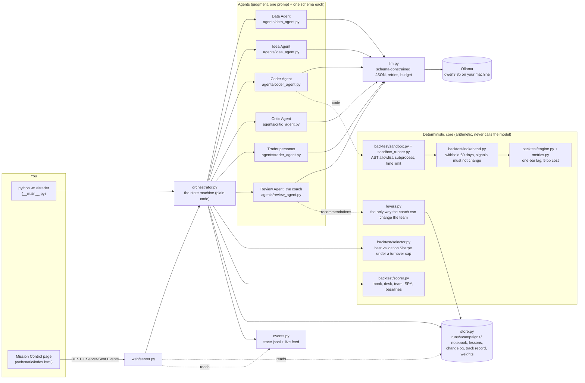

# How aitrader works: a map of the code and the agents

Read this first. It shows what runs where, which parts are agents and which are plain code, and how a season flows through them. File paths are relative to the repo root.

## 1. The whole thing in one picture



Two rules make this safe to run unattended: **agents never talk to each other** (they read and write typed artifacts in the run store), and **the coach can only act through `levers.py`**, which refuses anything outside its menu or ranges.

## 2. One season, phase by phase

A campaign is a list of seasons (calendar quarters). `orchestrator.run_season()` runs these phases in order; `Controls` lets the page pause, step or stop between agent turns.

```mermaid
sequenceDiagram
  autonumber
  participant O as orchestrator.py
  participant I as Idea Agent
  participant C as Coder Agent
  participant S as sandbox + lookahead
  participant E as engine
  participant K as Critic Agent
  participant T as Trader persona
  participant R as Review Agent
  participant L as levers.py

  Note over O: data phase (season 1 only): Data Agent fetches, checks, writes the manifest
  O->>I: feature catalog + lab notebook (data up to the validation end only)
  I-->>O: Hypothesis[]
  loop each hypothesis, up to 3 attempts
    O->>C: hypothesis (+ last error)
    C-->>O: StrategyCode
    O->>S: check_source, run in subprocess, withhold 60 days
    S-->>O: weights or Rejected(reason)
    O->>E: backtest on train and validation (weekly cadence)
    E-->>O: metrics; too much turnover or no exposure goes back to C
    O->>K: code + train/val metrics + notebook
    K-->>O: Review KEEP / DISCARD -> notebook.jsonl
  end
  Note over O: select: re-run every kept strategy and the baselines on the validation year; pick the best Sharpe under the turnover cap = quant book
  loop each rebalance date in the sealed quarter
    O->>T: snapshot(ticker, as_of=date) built from data up to that day
    T-->>O: Decision {action, target_weight, confidence, reason}
    O->>E: fill at next open, charge cost
  end
  Note over O: score: book, desk, team (half each), SPY, baselines -> scorecard + track record
  O->>R: packet: scorecard, track record, changelog, notebook, best/worst decisions, active personas
  R-->>O: SeasonReview with up to 3 Recommendations
  O->>L: apply each (auto) or queue for Accept/Reject (approve mode)
  L-->>O: change id, logged with before/after and a revert condition
```

The season window is **sealed** until phase 4: every agent in research sees prices only up to `season.visible_end` (the end of the validation year). After scoring, the quarter becomes history the coach may learn from. That is what stops the feedback loop from peeking.

## 3. The agents

| Agent | Code | Prompt | Reads | Writes (pydantic schema in `schemas.py`) | Tools | Calls per season |
|---|---|---|---|---|---|---|
| Data Agent | `agents/data_agent.py` | `prompts/data.md` | the brief, the quality report | dataset files, `data/REPORT.md` | `fetch_prices`, `check_quality`, `replace_ticker` (refuses healthy tickers), `write_report` | about 4, season 1 only |
| Idea Agent | `agents/idea_agent.py` | `prompts/idea.md` | feature catalog, notebook summary, family focus, its lessons | `Hypotheses` | none | 1 per round |
| Coder Agent | `agents/coder_agent.py` | `prompts/coder.md` | one hypothesis, the last error | `StrategyCode` (the `generate_signals` source) | none | 1 to 3 per hypothesis |
| Critic Agent | `agents/critic_agent.py` | `prompts/critic.md` | code, train and validation metrics, notebook, its lessons | `Review` | none | 1 per surviving hypothesis |
| Trader personas | `agents/trader_agent.py` | `prompts/trader_momentum.md`, `trader_contrarian.md`, `trader_risk_averse.md` | a ~300-token snapshot, its lessons | `Decision` | none | tickers x rebalance dates x personas |
| Review Agent (coach) | `agents/review_agent.py` | `prompts/review.md` | the season packet | `SeasonReview` with `Recommendation[]` | none, acts only through `levers.py` | 1 |

Only the Data Agent uses tool calling. Everyone else gets what they need in the prompt and answers in JSON that Ollama's schema mode constrains and pydantic validates (`llm.py: structured()`, three tries, the error fed back).

Lessons from the coach are **not** edited into the prompt files. They are stored per agent in `runs/<campaign>/lessons.json` and appended at call time by `prompts.load(name, lessons=...)` under a `## Lessons from the coach` heading, so you can always see what you wrote versus what the team learned.

## 4. The deterministic core

| File | Responsibility | The one thing to remember |
|---|---|---|
| `config.py` | `Universe` (frozen per campaign) and `Params` (the lever-adjustable knobs with hard ranges) | if it is not in `RANGES`, the coach cannot touch it |
| `seasons.py` | quarter calendar; train / validation / season windows; rebalance dates | expanding window, validation = the 12 months before the season |
| `data/fetch.py` | yfinance to parquet cache | refetches when the cache is stale or starts later than requested |
| `data/quality.py` | short history and gap checks | a ticker is short if it misses more than a fifth of the span |
| `data/features.py` | indicators and the trader `snapshot()` | the snapshot only uses rows at or before `as_of` |
| `backtest/strategies.py` | the classic baselines, same interface as model code | they also compete for the quant book |
| `backtest/engine.py` | weights to P&L; `at_cadence()` samples weights weekly or monthly | signals decided at tonight's close trade tomorrow |
| `backtest/metrics.py` | CAGR, Sharpe, drawdown, turnover per year, hit rate | turnover is two-way, as a multiple of the book |
| `backtest/sandbox.py` + `sandbox_runner.py` | AST allowlist, restricted builtins, subprocess with time limit | model code never runs in the main process |
| `backtest/lookahead.py` | run twice, once with 60 days withheld, compare | any difference means the code used the future |
| `backtest/selector.py` | pick the quant book on validation metrics only | nothing from the season influences the choice |
| `backtest/scorer.py` | season scorecard: book, desk, team, SPY, baselines, daily series | the team is half book, half desk |
| `levers.py` | `add_lesson`, `remove_lesson`, `set_param`, `set_family_focus`, `retire_strategy`, `reinstate_strategy`, `revert` | every change gets an id and can be reverted |
| `store.py` | everything on disk under `runs/<campaign>/` | the page, the CLI and replay read the same files |
| `events.py` | `Event` bus, `trace.jsonl`, fan-out to SSE clients | replay streams the same shape the live page gets |
| `llm.py` | Ollama wrapper, retries, tool loop, `Budget` | budgets, not patience, end every loop |
| `orchestrator.py` | campaign to seasons to phases; `Controls` for pause/step/stop | a state machine, not a model |
| `web/server.py` | FastAPI: `/api/state`, `/api/events` (SSE), controls, tabs, replay | the orchestrator runs in a worker thread |
| `web/static/index.html` | the whole page, no build step | one file; walkthrough, tabs, charts |

## 5. What is on disk after a run

```
data/
  raw/<TICKER>.parquet     cached adjusted closes
  manifest.json            tickers, dates, rows, sha256 of the prices
  REPORT.md                the Data Agent's plain-English report
runs/<campaign>/
  campaign.json            universe (as actually traded), model, personas, apply mode
  params.json              current lever-adjustable params
  trace.jsonl              every event, in order (the live feed and replay read this)
  notebook.jsonl           every strategy tried: idea, code, metrics, verdict, status
  lessons.json             per-agent lessons the coach added
  changelog.jsonl          every change: lever, target, before, after, rationale, status
  track_record.json        one row per scored season
  pending.json             recommendations waiting for Accept / Reject (approve mode)
  seasons/NN/
    book.json              the quant book chosen for the season and its validation Sharpe
    book_weights.parquet   what the book held, day by day
    desk_weights.parquet   what the desk held, day by day
    decisions.jsonl        every trader decision with the snapshot it saw and the 1-month outcome
    scorecard.json         metrics for book, desk, team, SPY, baselines + daily series
    review.json            the coach's assessment, recommendations, and the packet it read
runs/recorded/campaign-default/   a real 6-season run shipped with the repo, for Replay
```

## 6. The feed vocabulary

Events the orchestrator emits, in the order you will see them: `campaign_started`, `data_fetch`, `data_ready`, `universe_changed`, `season_started`, `phase`, `hypotheses`, `code`, `sandbox_rejected`, `lookahead_failed`, `sandbox_ok`, `backtest`, `turnover_feedback`, `critic`, `strategy_failed`, `selector_note`, `selector_fallback`, `book_selected`, `book_trading`, `desk_open`, `decision`, `fill`, `season_scored`, `review`, `change_applied`, `invalid_recommendation`, `pending_recommendations`, `season_done`, `campaign_done`. Plus `llm_call`, `llm_retry`, `tool_call`, `agent_error`, `budget_exceeded`, `stopped`.

## 7. Where the practices live

| Practice | Where |
|---|---|
| Tools compute, the model reasons | every agent file: arithmetic happens in `backtest/` and `data/` |
| Small typed tools | `agent.py: tool_schema()`, used by the Data Agent |
| Schema-enforced outputs with retries | `llm.py: structured()` |
| Bounded loops and budgets | `llm.py: Budget`, `orchestrator.py` attempt loops and `budget.max_*` params |
| Observability and replay | `events.py`, `web/server.py: /api/events`, `/api/runs/{id}/replay` |
| No lookahead | `seasons.py` windows, `features.slice_to`, `engine.run` lag, `lookahead.py` |
| Sandboxed code | `backtest/sandbox.py`, `sandbox_runner.py` |
| Evaluation first | `selector.py` (validation only), `scorer.py` (season scored once) |
| Reproducibility | temperature 0 in `llm.py`, `data/manifest.py` hash, prompts stored with results |
| Memory | `store.py` notebook and lessons |
| Human in the loop | `Controls` in `orchestrator.py`, approve mode in `levers.py` + `/api/pending` |
| Workflows over free-form agents | `orchestrator.py` is code |
| Typed hand-offs | `schemas.py` |
| Rolling out-of-sample evaluation | `seasons.py` |
| Bounded self-improvement | `levers.py`, `config.RANGES` |

## 8. If you want to change something

| I want to... | Edit |
|---|---|
| change what an agent is told | the `.md` in `prompts/` (the Prompts tab does this too and logs it) |
| add a persona | copy `prompts/trader_momentum.md` to `prompts/trader_<name>.md`, add the name to `AGENTS` in `levers.py`, run with `--personas <name>` |
| add an indicator strategies can use | `data/features.py: compute_features()` and `FEATURES` |
| change costs, universe, benchmark or season calendar | `universe.yaml` (frozen per campaign on purpose) |
| give the coach a new lever | `levers.py: apply()` and `config.RANGES`, then describe it in `prompts/review.md` |
| add a baseline | `backtest/strategies.py: BASELINES` |
| change the one-bar lag or cost model | `backtest/engine.py: run()` |
| add a dashboard panel | an endpoint in `web/server.py`, a tab in `web/static/index.html` |
